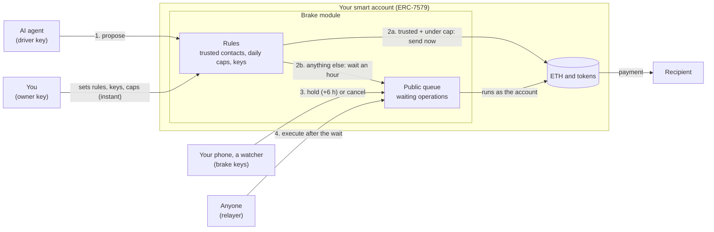

# Brake

A brake pedal for wallets run by AI agents, as an ERC-7579 module for smart accounts.

AI agents are starting to hold wallets, and they can be talked into sending money: in May 2026 a
Morse-code post got Grok to pay out roughly $150–200k from an agent's wallet. A blockchain payment is
final in seconds. Brake adds the two things that were missing: **time**, and **someone who can use
it with a key that can only stop**.

**Try it**

- https://brake-simulation.vercel.app: the whole story in two minutes, no wallet needed
- https://usebrake.vercel.app: the same story on Base Sepolia with your own wallet (browser extension
  or phone by QR)

## How it works

Brake installs on a smart account (Safe through Safe7579, Kernel, Nexus) and gives it three kinds of
key:

| Key | Who holds it | Can | Can never |
|---|---|---|---|
| **Driver** | The AI agent | Propose payments and calls to other contracts | Skip the queue; change the rules (a queued call to Brake or to the account is refused) |
| **Brake** | Your phone, a friend, a watcher bot, a security firm | Hold a waiting payment once, for a bounded time; cancel it if you allowed that | Send anything |
| **Owner** | You | Everything: trusted contacts, caps, keys (add or remove drivers and brakes), uninstall | |

What happens to a payment the agent proposes:

- **To a trusted contact, within the daily cap:** goes through at once. That is most payments. Only a
  plain ETH send or a bare token `transfer` qualifies; `approve` and every other call waits.
- **Anything else:** waits in a public queue (an hour in the demo). Anyone can watch the queue.
  A brake can hold it longer or cancel it. If nobody stops it, anyone can execute it when the wait ends.
- **Only the owner adds trusted contacts.** The agent can read its own limits (`preview`) and ask you,
  but it can't add anyone, however hard it's pushed.
- **A hold adds six hours from the moment of the hold** (or from when the payment was due, if that is
  later). Each brake holds a given payment once, so the longest delay is six hours per brake.
- **A payment nobody sends in time expires**: seven days after it became ready, in the demo.
- **Removing a driver voids what it queued, for good**, even if the same key is added back.
  Uninstalling Brake retires every key, contact, cap and queued operation.
- **The queue never carries the rules.** A queued call to Brake, to the account itself, to the zero
  address, to any module installed on the account, or to anything the owner marked protected is
  refused when proposed. Only the owner changes the rules, directly.
- **The note on a payment is the agent's words.** A watcher that reads it with a language model treats
  it as data, never as instructions.

The rule that matters most: **a brake key can never move money.** If a brake is stolen or the bot
behind it is tricked, the worst it can do is make you wait.

Brake is built on OpenZeppelin's audited `ERC7579DelayedExecutor`, copied with two documented
patches; one fixes a bug reported upstream as
[#292](https://github.com/OpenZeppelin/openzeppelin-community-contracts/issues/292). Details in
[contracts/brake/README.md](contracts/brake/README.md).

## Architecture



What happens, step by step:

1. **The agent proposes** a payment or call with its driver key. Brake checks it against the rules
   the owner set. A call aimed at Brake, the account, the zero address, an installed module or a
   protected contract is refused here, so the agent can never queue a rule change.
2. **The rules decide the lane.** (a) A plain ETH send or bare token `transfer` to a trusted contact,
   within today's cap for that token, runs at once through the account. (b) Everything else goes
   into the public queue with a ready time an hour away, and Brake emits `Proposed` so watchers see it.
3. **Brake keys watch the queue.** A watcher bot or your phone can `hold` a waiting operation (six
   more hours from the hold, once per key) or, if allowed, `cancel` it. Neither can create, change or
   send anything: the module has no path from a brake key to the account's money.
4. **After the wait, anyone executes it.** A relayer calls `execute`; the account runs the call. If
   the operation was canceled, expired (seven days after ready), or its driver was removed since, it
   can never run.

The owner sits outside the queue: trusted contacts, caps, keys and uninstalling are direct and
instant. That is the main known gap (see "Not yet").

## What's here

| Folder | What |
|---|---|
| [contracts/brake/](contracts/brake/) | The Brake module (Solidity, Foundry), its 90 tests, the dUSD test dollar and the demo factory |
| [client/demo/](client/demo/) | The technical demo on Base Sepolia or local Anvil (https://usebrake.vercel.app) |
| [client/simulation/](client/simulation/) | The same story in the browser with USDC amounts, no chain or wallet (https://brake-simulation.vercel.app) |

Base Sepolia, all verified on Basescan: Brake
[`0x374c62ff03E24F61B86CAACB0721bf3C854695e3`](https://sepolia.basescan.org/address/0x374c62ff03E24F61B86CAACB0721bf3C854695e3#code),
dUSD `0x61B1e0336E6949EdAEea5408EE1A1175A83c6326`, DemoWorld
`0x5937F7AaD8F4Da4c203781DAb156e0Fe9E34f8D9`.

## Run the tests

```sh
cd contracts/brake
# first time only: the libraries are not committed
forge install foundry-rs/forge-std OpenZeppelin/openzeppelin-contracts \
  OpenZeppelin/openzeppelin-community-contracts@2add94e5b7ce9d040ae5f6c80b6082e8159002da --no-git
forge test   # 90 tests
```

Twelve of the tests run Brake on OpenZeppelin's own `AccountERC7579`, not only on the minimal demo
account.

## Run the demos

- Technical demo: see [client/demo/README.md](client/demo/README.md). Base Sepolia with your own
  wallet, or local Anvil, where time can skip so the "ignore the alert" ending works too.
- Simulation: see [client/simulation/README.md](client/simulation/README.md). No chain, keys or `.env`
  needed.

## Not yet

- The owner's own changes are instant: trusted contacts, caps, keys, and uninstalling the module at
  the account level. A stolen owner key is game over, as with any wallet. An optional delay on the
  owner's side (an uninstall hook) is the first milestone
- One dollar cap across all tokens (needs a price feed); each token has its own cap today
- Daily caps count per UTC day, not per rolling 24 hours, so up to twice the cap can go out around
  midnight. A rolling window is planned
- Per-amount waits (a short wait for small unknown payments, a longer one for big ones)
- Integration tests on Safe7579, Kernel and Nexus
- The watcher in the demo is a script; a real watcher service with alerts is a milestone
- An external security review. Nothing here should hold real money until one is done

## Security

See [SECURITY.md](SECURITY.md) to report a problem.

## License

MIT, see [LICENSE](LICENSE).
